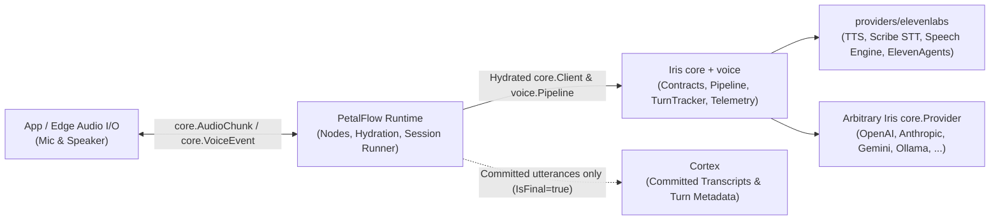

# PetalFlow Voice Integration Specification

**Status**: Active Specification (Iris `#160` / `IRIS-VOICE-017`)  
**Applies to**: `github.com/petal-labs/iris` (upstream), `github.com/petal-labs/petalflow` (orchestration), and `github.com/petal-labs/cortex` (memory/transcript persistence)  
**Source FRD**: Iris — ElevenLabs Voice Integration FRD

This specification defines the exact typed node/tool port contracts, full-duplex session boundaries, credential hydration rules, observability wiring, and integration acceptance gates for integrating Iris voice capabilities into **PetalFlow** (issues `#249`–`#254`) and coordinating downstream **Cortex** persistence (`#76`–`#80`).

---

## 1. Repository Ownership & Architecture Boundaries

Responsibilities are strictly partitioned across the three repositories so protocol code, workflow orchestration, and persistent memory never bleed into one another:

| Layer | Owner | Responsibilities | Explicitly Out of Scope |
|---|---|---|---|
| **Speech & Provider SDK** | **Iris** (`core`, `providers/elevenlabs`, `voice`, `contrib/otel`) | Provider-agnostic audio/speech types, optional capability interfaces, ElevenLabs HTTP/WebSocket/Speech Engine/ElevenAgents adapters, `voice.Pipeline`, privacy-safe `VoiceTelemetryHook` / OTel instrumentation | Graph/DAG scheduling, workflow persistence, microphone/speaker hardware drivers |
| **Workflow & Session Orchestration** | **PetalFlow** (`#249`–`#254`) | Typed Transcription/Synthesis DAG nodes, credential hydration into Iris clients, session-oriented runtime execution, tool-node dispatch into `VoiceSession`, graph-level cancellation and backpressure | Direct ElevenLabs wire framing, raw secret logging, hardware audio capture/playback |
| **Persistent Conversational Memory** | **Cortex** (`#76`–`#80`) | Opt-in persistence of committed utterances (`IsFinal == true`), session & turn metadata (`SessionID`, `TurnID`), retention/privacy policies, voice history retrieval | Storing raw audio bytes by default, persisting ephemeral partial hypotheses |
| **Application / Edge** | **Host App** | Microphone capture, speaker playback, VAD/AEC at device edge, audio encoding/decoding to `core.AudioFormat` | Provider credentials in untrusted clients (use signed URLs for ElevenAgents) |



---

## 2. Typed Node and Tool Port Contracts

### 2.1 Transcription Node (`petalflow#249`)

Converts buffered or streaming audio inputs into structured transcripts via Iris's `core.SpeechRecognizer` interface.

- **Capability Preflight** (executed during workflow validation / node hydration):
  - Verify `_, ok := core.AsSpeechRecognizer(provider)` (walks `core.ProviderUnwrapper` chains).
  - Verify `core.ProviderSupportsModelFeature(provider, model, core.FeatureSpeechRecognition)` when using catalog models (`elevenlabs.ModelScribeV1`, `elevenlabs.ModelScribeV2`).
- **Typed Input Port -> `core.TranscriptionRequest`**:

| PetalFlow Port Field | Iris Field | Type | Required | Constraints / Notes |
|---|---|---|---|---|
| `audio` | `Audio` | `*core.AudioData` | XOR `reader` | Supports automatic bounded retry via `core.Client.Transcribe` |
| `reader` | `Reader` | `io.Reader` | XOR `audio` | Streamed multipart upload; **not retried** because `io.Reader` is non-rewindable |
| `filename` | `Filename` | `string` | Optional | Multipart filename hint (e.g., `"meeting.mp3"`) |
| `format` | `Format` | `core.AudioFormat` | Optional | Raw PCM requires mono `16000Hz` (`pcm_s16le_16`) on ElevenLabs Scribe |
| `model` | `Model` | `core.ModelID` | Optional | Defaults to `elevenlabs.ModelScribeV2` |
| `language` | `Language` | `string` | Optional | ISO-639 / BCP-47 hint; empty auto-detects |
| `keyterms` | `Keyterms` | `[]string` | Optional | Max `1,000` (`elevenlabs.MaxScribeKeyterms`); `scribe_v2` only |
| `diarize` | `Diarize` | `bool` | Optional | Enables speaker diarization |
| `num_speakers` | `NumSpeakers` | `*int` | Optional | Max `32` (`elevenlabs.MaxScribeSpeakers`) |
| `timestamps` | `Timestamps` | `core.TranscriptionTimestampGranularity` | Optional | `none`, `word`, or `character` (`segment` rejected preflight by Scribe) |
| `tag_audio_events` | `TagAudioEvents` | `bool` | Optional | Tags non-speech events (laughter, applause, etc.) |
| `temperature` | `Temperature` | `*float64` | Optional | Must be in `[0.0, 2.0]` (`elevenlabs.MaxScribeTemperature`) |
| `max_bytes` | `MaxBytes` | `int64` | Optional | Defaults to `100 MiB` (`elevenlabs.DefaultMaxTranscriptionBytes`) |

- **Typed Output Port <- `*core.TranscriptionResponse`**:
  - `text` (`Text`), `language` (`Language`), `duration` (`Duration`), `words` (`[]core.TranscriptionWord`), `segments` (`[]core.TranscriptionSegment`), `audio_events` (`[]core.AudioEvent`), `is_final` (`IsFinal == true`).
- **Invocation**: `client.Transcribe(ctx, req)`.

### 2.2 Synthesis Node (`petalflow#250`)

Converts text into complete or incrementally streamed audio payloads via Iris's `core.SpeechSynthesizer` interface.

- **Capability Preflight**:
  - Verify `_, ok := core.AsSpeechSynthesizer(provider)`.
  - For streaming mode (`mode == "stream"`), verify `core.ProviderSupportsModelFeature(provider, model, core.FeatureSpeechSynthesisStreaming)`.
- **Typed Input Port -> `core.SpeechRequest`**:

| PetalFlow Port Field | Iris Field | Type | Required | Constraints / Notes |
|---|---|---|---|---|
| `text` | `Text` | `string` | Yes | Non-blank synthesis text |
| `voice_id` | `VoiceID` | `string` | Yes | ElevenLabs voice ID (discoverable via `ListVoices` / `GetVoice`) |
| `model` | `Model` | `core.ModelID` | Optional | Defaults to `elevenlabs.ModelElevenMultilingualV2` |
| `format` | `Format` | `core.AudioFormat` | Optional | Defaults to `core.AudioFormatMP3_44100_128`; mono MP3, PCM, G.711 (`ulaw`/`alaw`), Opus only |
| `language` | `Language` | `string` | Optional | ISO-639 / BCP-47 hint |
| `voice_settings` | `VoiceSettings` | `*core.VoiceSettings` | Optional | `Speed > 0`; `Stability`, `SimilarityBoost`, `Style` in `[0.0, 1.0]` |
| `seed` | `Seed` | `*int64` | Optional | Non-negative deterministic seed |
| `previous_text` / `next_text` | `PreviousText` / `NextText` | `string` | Optional | Prosody continuity context across split chunks |
| `mode` | *(node config)* | `"sync"` \| `"stream"` | Optional | Selects `client.Synthesize` vs `client.StreamSynthesize` |

- **Typed Output Port**:
  - **`sync` mode**: `*core.SpeechResponse` (`Audio` with `Format` + bytes, `Usage.OutputBytes`, `Usage.InputCharacters`).
  - **`stream` mode**: `*core.SpeechStream` (`Ch <-chan core.AudioChunk`, `Err <-chan error`, `Final <-chan *core.SpeechResponse`). Downstream DAG nodes that require a single buffer MUST use `core.DrainSpeechStream(ctx, stream)` so late errors on `Err` are never lost.
- **Cancellation Rule**: Cancelling the node's `ctx` promptly closes the HTTP body and closes `Ch`, `Err`, and `Final` without leaking goroutines.

### 2.3 Tool Ports Inside Voice Sessions (`petalflow#253`)

PetalFlow workflows expose tools to voice sessions through three Iris-supported execution bindings:

1. **Registry-Backed Automatic Tools (Recommended for Local/Middleware Tools)**:
   - Register PetalFlow tools implementing `tools.Tool` in a `*tools.Registry` (with validation, timeout, retry, and circuit-breaker middlewares) and pass `ToolExecutor: voice.RegistryToolExecutor(reg)` into `voice.PipelineConfig`.
2. **Direct Executable Tools**:
   - Pass `tools.Tool` implementations in `PipelineConfig.Tools` (or `VoiceSessionConfig.Tools`); `voice.Session` executes `Call(ctx, args)` automatically with `ToolTimeout` (default `30s`) and `MaxToolRounds` (default `5`).
3. **Graph / External Schema-Only Tool Ports (Required for Hosted ElevenAgents & Sub-Graph Routing)**:
   - Register schema-only `core.Tool` definitions (or configure client tools in ElevenAgents).
   - PetalFlow's session runner observes `core.VoiceEventToolCall` (`TurnID`, `ToolCall{ID, Name, Arguments}`), dispatches the call to a PetalFlow tool node or sub-graph using the turn/session context, and submits the outcome via `sess.SubmitToolResult(ctx, core.ToolResult{CallID, Content, IsError})`.
   - If the user interrupts the turn while a tool is running, PetalFlow MUST cancel the tool node's context and ignore any late result (`ErrToolCallNotFound` is expected if the turn was already superseded).

---

## 3. Session Boundary & Execution Modes (`petalflow#252`, `#253`)

Unlike stateless DAG nodes that start, execute once, and terminate, interactive voice workflows require a **session-oriented execution boundary** wrapping `core.VoiceSession`.

### 3.1 Supported Voice Session Modes (Must Not Be Conflated)

PetalFlow MUST expose an explicit `mode` selector rather than conflating the three Iris voice modes:

| Mode | Iris Entrypoint | Who Runs the LLM? | Raw Audio Access in PetalFlow? | Recommended Use Case |
|---|---|---|---|---|
| **`iris_pipeline`** *(default)* | `voice.NewPipeline(...).StartVoiceSession(ctx, cfg)` | **Iris / PetalFlow** (any `core.Provider`: OpenAI, Anthropic, Gemini, Ollama, etc.) | Yes (`SendAudio` / `VoiceEventAudioOutput`) | Full control over LLM choice, prompt/memory injection, PetalFlow tool routing, and multi-provider fallback |
| **`speech_engine`** | `provider.NewSpeechEngineHandler(cfg)` (`http.Handler`) | **Iris / PetalFlow** (any `core.Provider`) | No (ElevenLabs owns STT/TTS; sends `user_transcript`, receives `agent_response`) | Deploying a publicly reachable Go WebSocket server (`wsUrl`) backed by ElevenLabs' managed audio/turn-taking stack |
| **`elevenagents`** | `client.StartVoiceSession(ctx, cfg)` / `provider.StartAgentSession(ctx, cfg)` | **ElevenLabs Hosted Agent** | Yes (`SendAudio` / `VoiceEventAudioOutput`) | Connecting to an existing hosted ElevenLabs Conversational AI agent with client-side tool callbacks |

### 3.2 Session Event & Interruption Semantics

Every PetalFlow session runner consuming `sess.Events()` MUST enforce:

1. **Partial vs. Committed Transcript Separation**:
   - `core.VoiceEventUserTranscriptPartial` (`IsFinal == false`) and `core.VoiceEventAgentTextDelta` (`IsFinal == false`) are forwarded to live UI/streaming subscribers only and **MUST NOT** be written to Cortex persistent memory.
   - `core.VoiceEventUserTranscriptCommitted` (`IsFinal == true`) and `core.VoiceEventAgentTextCommitted` (`IsFinal == true`) carry stable utterances correlated by `SessionID` and `TurnID` for Cortex ingestion (`cortex#76`, `#77`).
2. **Stale-Audio Suppression on Interruption**:
   - PetalFlow audio sinks MUST attach a `core.NewVoiceTurnTracker("pf")` consumer guard:
     ```go
     tracker := core.NewVoiceTurnTracker("pf")
     for evt := range sess.Events() {
         tracker.ObserveEvent(evt)
         if evt.Type == core.VoiceEventAudioOutput && !tracker.ShouldPlayAudio(evt) {
             continue // Drop stale audio from interrupted/superseded turns.
         }
         // Dispatch evt to playback sink or workflow subscribers.
     }
     ```
   - On `core.VoiceEventTurnInterrupted`, audio playback sinks MUST immediately flush any client-side audio buffer belonging to `evt.Interruption.CancelledTurnID`.
3. **Bounded Channels & Error Separation**:
   - `sess.Events()` is bounded (`EventBufferSize`, default `64`). Slow downstream PetalFlow consumers MUST NOT buffer events unboundedly in memory.
   - Session-fatal transport failures arrive on `<-sess.Err()` and close `Events()`.
   - Recoverable turn errors (e.g., transient LLM rate limit or `voice.ErrMaxToolRoundsExceeded`) arrive as `core.VoiceEventError` tagged with `TurnID` while keeping the session alive.
4. **Deterministic Teardown**:
   - PetalFlow session nodes MUST always `defer sess.Close()`. `Close()` is idempotent, concurrency-safe, and guaranteed not to deadlock even if `Events()` is full.

---

## 4. Credential & Provider Hydration (`petalflow#251`)

PetalFlow hydrates provider credentials from its secret store / environment into Iris providers without ever exposing raw secrets to workflow state, logs, or telemetry:

1. **Secret Resolution**:
   - Resolve `ELEVENLABS_API_KEY` (plus LLM provider keys for `iris_pipeline` / `speech_engine`) at execution start.
   - Construct providers with `elevenlabs.New(apiKey, opts...)` (or `providers.Create("elevenlabs", apiKey)`). Iris immediately wraps `apiKey` in `core.Secret` and scrubs it from `String()`, `GoString()`, JSON, and upstream error messages.
   - Configure bounded transport options explicitly at hydration time:
     - `elevenlabs.WithHTTPClient(customClient)` (shared connection pool / proxy)
     - `elevenlabs.WithTimeout(30 * time.Second)`
     - `elevenlabs.WithStreamChunkSize(16 * 1024)` and `elevenlabs.WithStreamBufferSize(16)`
2. **Client Wrapping & Observability**:
   - Wrap the provider with `core.NewClient(provider, core.WithRetryPolicy(...), core.WithRateLimiter(...), core.WithVoiceTelemetry(voiceHook))`.
   - For OpenTelemetry deployments, pass `irisotel.NewVoiceHook(...)` (`github.com/petal-labs/iris/contrib/otel`) to both `core.WithVoiceTelemetry` and `voice.PipelineConfig.Telemetry`.
3. **Private ElevenAgents Signed-URL Hydration**:
   - When PetalFlow mediates an untrusted or browser client connecting to a private ElevenAgents agent, PetalFlow's trusted backend calls `provider.GetAgentSignedURL(ctx, &elevenlabs.AgentSignedURLRequest{AgentID: ...})` and transmits only the short-lived `SignedURL` (stored as `core.Secret` in Iris), never `ELEVENLABS_API_KEY`.
   - For server-side sessions, `client.StartVoiceSession(ctx, core.VoiceSessionConfig{AgentID: ...})` automatically mints and dials a temporary signed URL.
4. **Model Compatibility Preflight**:
   - Before dialing incremental WebSocket TTS (`voice.Pipeline` with `RealtimeTTS`), PetalFlow MUST verify `core.ProviderSupportsModelFeature(p, ttsModel, core.FeatureSpeechSynthesisRealtime)`. `eleven_v3` is supported for sync and HTTP streaming TTS (`FeatureSpeechSynthesis`, `FeatureSpeechSynthesisStreaming`) but **rejected** (`core.ErrNotSupported`) on ElevenLabs' `/stream-input` WebSocket endpoint.

---

## 5. Cross-Repository Dependency Matrix

Per the FRD gate policy, downstream PetalFlow and Cortex issues depend on the following upstream Iris deliverables:

| Downstream Issue | Repository | Blocking Iris Issues | Iris Status |
|---|---|---|---|
| `#249` Transcription node | PetalFlow | `#144`, `#145`, `#146`, `#149` | **Unblocked** (merged) |
| `#250` Synthesis node | PetalFlow | `#144`, `#145`, `#147`, `#148` | **Unblocked** (merged) |
| `#251` Credential hydration | PetalFlow | `#145`, `#146` | **Unblocked** (merged) |
| `#252` Session-oriented execution | PetalFlow | `#155`, `#156` | **Unblocked** (merged) |
| `#253` Voice agent integration | PetalFlow | `#153`, `#154`, `#155`, `#156` | **Unblocked** (merged) |
| `#254` Voice examples/tests | PetalFlow | `#148`, `#149`, `#156`, `#162` | Waiting on Iris `#162` |
| `#76` Committed transcript persistence | Cortex | `#144`, `#149` | **Unblocked** (merged) |
| `#77` Session and turn metadata | Cortex | `#155` | **Unblocked** (merged) |
| `#78` Voice history retrieval | Cortex | `#149`, `#156` | **Unblocked** (merged) |
| `#79` Transcript privacy/retention | Cortex | `#149` | **Unblocked** (merged) |
| `#80` Integration tests and example | Cortex | `#155`, `#156`, `#162` | Waiting on Iris `#162` |

---

## 6. Integration Acceptance Gates

Every PetalFlow PR implementing `#249`–`#254` MUST pass the following five acceptance gates:

1. **Deterministic Offline Tests (CI-Required)**:
   - Unit and workflow tests mock `core.SpeechSynthesizer`, `core.SpeechRecognizer`, `core.RealtimeSpeechRecognizer`, `core.RealtimeSpeechSynthesizer`, and `core.VoiceSession` without requiring live network access or `ELEVENLABS_API_KEY`.
   - Cover happy paths, typed provider errors (`ErrUnauthorized`, `ErrRateLimited`, `ErrBadRequest`, `ErrServer`, `ErrNetwork`), invalid inputs, and tool failures.
2. **Cancellation, Interruption & Race Gate (`go test -race ./...`)**:
   - Cancelling workflow/node `ctx` mid-stream closes all channels and exits with zero leaked goroutines.
   - Barge-in / `Interrupt(ctx)` cancels in-flight LLM/tool/TTS work and proves zero stale `VoiceEventAudioOutput` chunks from cancelled turns are forwarded to playback.
   - Calling `Close()` when a consumer has stopped draining a full bounded `Events()` buffer returns promptly without deadlock.
3. **Preflight Compatibility Gate**:
   - Unsupported provider capabilities return `core.ErrNotSupported`.
   - Unsupported formats (`wav`/`stereo` TTS, non-16kHz PCM Scribe) and unsupported models (`eleven_v3` on incremental WebSocket TTS, `keyterms` on `scribe_v1`) fail fast before outbound network I/O.
4. **Privacy, Redaction & Cortex Hygiene Gate**:
   - Automated test assertions verify that workflow logs, error strings, OTel spans, and OTel metrics contain **zero** API keys, signed URLs, raw audio bytes, prompts, or transcript text.
   - Cortex persistence tests verify that only committed transcripts (`IsFinal == true`) are persisted and raw audio bytes are excluded by default.
5. **Optional Credentialed Live Gate (`//go:build integration`)**:
   - Live smoke tests gated on `ELEVENLABS_API_KEY` (and `ELEVENLABS_AGENT_ID` for hosted ElevenAgents) pass end-to-end when credentials are supplied and skip cleanly when unset.

---

## 7. Known Limitations

- **Audio I/O**: Iris and PetalFlow operate strictly on byte buffers, `io.Reader`, and `core.AudioChunk` streams; microphone capture, playback, and codec transcoding remain application/edge responsibilities.
- **Model/Endpoint Matrix**: `eleven_v3` is compatible with synchronous and HTTP streaming TTS (`Synthesize`, `StreamSynthesize`), not ElevenLabs' `/v1/text-to-speech/{voice_id}/stream-input` WebSocket endpoint (which requires `eleven_flash_v2_5` or `eleven_multilingual_v2`).
- **Non-Rewindable Readers**: `core.Client.Transcribe` cannot automatically retry requests backed by `TranscriptionRequest.Reader`; pass `AudioData` when automatic transient retries are required.
- **Speech Engine Deployment**: `elevenlabs.SpeechEngineHandler` requires a publicly reachable HTTPS/WSS endpoint (`wsUrl`) because ElevenLabs dials into your server; use `voice.Pipeline` when inbound server hosting is unavailable.
- **Hosted Reasoning Boundary**: ElevenAgents runs its own hosted LLM and prompt on ElevenLabs; selecting an external Iris LLM requires `voice.Pipeline` or `SpeechEngineHandler`.
- **Upcoming Iris Work**: Consent-gated voice cloning/management (`#161`) and end-to-end real-time voice-agent integration tests + first-audio latency benchmarks (`#162`) are tracked in subsequent Iris issues.
